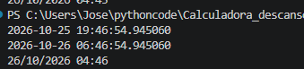

# Gestor de descansos

Programa en Python para calcular a qué hora puedo volver a conducir después de realizar un descanso diario.

La idea es ir añadiendo funciones poco a poco, mientras aprendo Python, hasta poder comprobar también los descansos semanales y bisemanales.

El objetivo final es **poder utilizarlo desde mi móvil Android**, de forma sencilla. Pulsar un botón al terminar la jornada y que el programa calcule automáticamente los descansos, sin tener que introducir fechas ni horas manualmente.

## Primera versión

De momento el programa:

- Obtiene la fecha y hora actuales.
- Calcula cuándo terminan las 11 horas de descanso normal.
- Calcula cuándo terminan las 9 horas de descanso reducido.
- Muestra los resultados por pantalla.

## Prueba de funcionamiento



## Próximos pasos

- Comprobar cuándo se puede utilizar un descanso reducido.
- Calcular los descansos semanales normales y reducidos.
- Controlar las compensaciones y los descansos entre semanas.
- Comprobar los cálculos según la normativa vigente.
- Crear una interfaz sencilla para utilizarlo en Android.

Por ahora solo calcula las horas. Todavía no comprueba si se cumplen todos los requisitos legales.

## Actualización — 29/10/2026

### Nuevas funcionalidades

- Introducción manual de fecha y hora de inicio de jornada.
- Posibilidad de calcular desde la fecha y hora actuales.
- Cálculo de descansos diarios normales de 11 horas.
- Cálculo de descansos diarios reducidos de 9 horas.
- Cálculo de la hora límite para iniciar un descanso de 9 horas dentro del período de 24 horas desde el final del descanso anterior.

### Cálculo del límite de 15 horas

Para determinar la última hora a la que debe comenzar un descanso de 9 horas:

```python
limite_jornada = hora_inicio + timedelta(hours=15)
```

Ejemplo:

```text
Inicio de jornada: 07:00
Hora límite para iniciar 9 horas de descanso: 22:00
```

Este cálculo también sirve para el segundo período de un descanso diario fraccionado de 3 + 9 horas, siempre que se hayan realizado previamente las primeras 3 horas ininterrumpidas.

**Limitación:** el programa calcula el límite horario, pero todavía no verifica el cumplimiento completo de la normativa, las pausas ni los tiempos de conducción.

### Conceptos de Python aprendidos

**1. `datetime.now()`**

Obtener la fecha y hora actuales.

```python
hora_actual = datetime.now()
```

**2. `datetime.strptime()`**

Convertir una cadena de texto en un objeto `datetime`.

```python
fecha = datetime.strptime("29/10/2026", "%d/%m/%Y")
hora = datetime.strptime("07:00", "%H:%M")
```

**3. `datetime.combine()`**

Combinar una fecha y una hora.

```python
hora_inicio = datetime.combine(fecha.date(), hora.time())
```

**4. `timedelta()`**

Representar una duración y realizar cálculos con fechas y horas.

```python
fin_descanso = hora_inicio + timedelta(hours=11)
```

**5. Validación de opciones con `while` y `not in`**

```python
while tipo_descanso not in ("1", "2", "3"):
    tipo_descanso = input("Selecciona una opción: ")
```

Permite repetir la pregunta hasta recibir una opción válida.

**6. Formatear fechas con `strftime()`**

```python
print(fin_descanso.strftime("%d/%m/%Y %H:%M"))
```

**7. Análisis estático con Ruff**

Instalación:

```bash
python -m pip install ruff
```

Comprobar el código:

```bash
python -m ruff check calcular_descanso.py
```

Aplicar formato:

```bash
python -m ruff format calcular_descanso.py
```

Aprendizaje: Ruff puede detectar variables declaradas pero no utilizadas, además de otros problemas de calidad del código. Sus advertencias deben revisarse antes de aplicar correcciones automáticas.


### Próximas mejoras

- Validación de entradas incorrectas.
- Comprobación completa del descanso fraccionado de 3 + 9 horas.
- Pruebas automatizadas con `assert`.
- Control de descansos diarios reducidos.
- Gestión de cambios de horario de verano e invierno.

### Referencia normativa

Reglamento (CE) 561/2006, artículos 4 y 8.

## Actualización — 01/11/2026

### Nueva funcionalidad: límite de inicio del descanso semanal

Se incorpora el cálculo de la fecha y hora límite para comenzar el siguiente descanso semanal, conforme a la regla general del artículo 8.6 del Reglamento (CE) 561/2006.

El programa permite:

- Introducir manualmente la fecha y hora de finalización del descanso semanal anterior.
- Calcular los seis períodos consecutivos de 24 horas (144 horas).
- Mostrar la fecha y hora límite para comenzar el siguiente descanso semanal.

### Ejemplo de funcionamiento

```text
Fin del descanso semanal anterior: 01/11/2026 18:33

Fecha y hora límite para iniciar el siguiente descanso semanal: 07/11/2026 18:33
```

El cálculo indica cuándo debe comenzar, como máximo, el siguiente descanso semanal. No significa que el conductor pueda conducir durante 144 horas ni que deba esperar hasta ese límite para descansar.

### Nuevas funciones

**`pedir_datos_semanal()`**

Solicita una fecha y una hora, las convierte en un objeto `datetime` y devuelve el resultado.

**`calcular_limite_semanal(fin_descanso_anterior)`**

Recibe la fecha y hora de finalización del descanso semanal anterior y calcula el límite de 144 horas.

```python
def calcular_limite_semanal(fin_descanso_anterior):
    limite = fin_descanso_anterior + timedelta(hours=144)
    return limite
```

### Conceptos de Python aprendidos

**1. Separación de responsabilidades**

En lugar de crear una única función que haga todo, se han separado la recogida de datos y el cálculo.

Esto facilita la reutilización del código, las pruebas y el mantenimiento.

**2. Parámetros y argumentos**

Una función puede recibir información procedente de otra función.

```python
limite = calcular_limite_semanal(fin_anterior)
```

**3. Uso de `return`**

Permite devolver un resultado para utilizarlo posteriormente, sin necesidad de mostrarlo directamente con `print()`.

**4. Variables locales**

Distintas funciones pueden utilizar variables con el mismo nombre sin interferir entre ellas.

**5. Comunicación entre funciones**

Se ha practicado cómo recoger el resultado de una función y pasarlo como argumento a otra.

### Próximas mejoras

- Calcular el final de los descansos semanales normales de 45 horas.
- Incorporar los descansos semanales reducidos y sus compensaciones.
- Comprobar el cumplimiento de las condiciones legales de los descansos semanales.
- Controlar los descansos en dos semanas consecutivas.
- Crear un menú principal para seleccionar el cálculo deseado.
- Separar progresivamente la lógica de cálculo de la interfaz de usuario.
- Incorporar pruebas automatizadas con `pytest`.

### Limitaciones actuales

El programa calcula el plazo general de 144 horas, pero todavía no comprueba el cumplimiento completo del Reglamento (CE) 561/2006, incluidas las excepciones aplicables, los descansos reducidos, las compensaciones y las reglas de dos semanas consecutivas.

**Referencia normativa:** Reglamento (CE) 561/2006, artículo 8, en su versión vigente.

## Actualización — 07/11/2026

### Nueva funcionalidad: cálculo y validación de descansos semanales

Se amplía el motor de cálculo de descansos conforme al artículo 8 del Reglamento (CE) 561/2006.

Se incorporan funciones para calcular descansos semanales normales y reducidos, determinar compensaciones pendientes y comprobar determinadas condiciones temporales.

El programa permite:

- Calcular la finalización de un descanso semanal normal de 45 horas.
- Comprobar si el siguiente descanso semanal comienza dentro del límite general de 144 horas.
- Detectar fechas cronológicamente incoherentes.
- Calcular descansos semanales reducidos de entre 24 y menos de 45 horas.
- Trabajar con horas y minutos.
- Calcular el tiempo pendiente de compensación.
- Determinar la fecha límite para compensar un descanso semanal reducido.
- Comprobar si un período de compensación tiene duración suficiente y finaliza dentro del plazo establecido.

### Ejemplo de funcionamiento: descanso semanal normal

```text
--- DESCANSO SEMANAL NORMAL ---
Fin descanso anterior: 2026-11-05 20:00:00
Límite para iniciar: 2026-11-11 20:00:00
Inicio nuevo descanso: 2026-11-11 18:00:00
Fin nuevo descanso: 2026-11-13 15:00:00
Resultado: CORRECTO: descanso iniciado dentro del plazo
```

Se comprueba que el nuevo descanso comienza antes de finalizar los seis períodos consecutivos de 24 horas desde el descanso semanal anterior.

También se han realizado pruebas con fechas fuera de plazo y cronológicamente incoherentes.

### Nueva funcionalidad: descanso semanal reducido

Se incorpora el cálculo de descansos semanales reducidos, incluyendo su duración exacta y las horas pendientes de compensación.

### Ejemplo de funcionamiento

```text
--- DESCANSO SEMANAL REDUCIDO ---
Inicio: 2026-11-07 18:15:00
Fin: 2026-11-09 00:40:00
Compensación: 14:35:00
Límite compensación: 2026-11-30 00:00:00
```

El programa calcula un descanso de 30 horas y 25 minutos y determina que quedan pendientes 14 horas y 35 minutos de compensación.

La fecha límite se calcula tomando como referencia el final de la tercera semana siguiente a la semana del descanso reducido.

### Nueva funcionalidad: comprobación de compensaciones

Se incorpora una primera validación de los períodos destinados a compensar descansos semanales reducidos.

El programa comprueba:

- Que la fecha de finalización sea posterior a la de inicio.
- Que el período termine dentro del plazo de compensación.
- Que la duración alcance las horas pendientes más un descanso de al menos 9 horas.

### Pruebas realizadas

**Prueba 1. Compensación con duración suficiente**

```text
Inicio: 2026-11-20 18:00:00
Fin: 2026-11-21 18:00:00
Duración: 1 day, 0:00:00
Resultado: CORRECTO: compensación completada
```

**Prueba 2. Compensación insuficiente**

```text
Inicio: 2026-11-20 18:00:00
Fin: 2026-11-21 16:00:00
Duración: 22:00:00
Resultado: INSUFICIENTE: faltan horas de descanso
```

**Prueba 3. Compensación fuera de plazo**

```text
Inicio: 2026-11-30 08:00:00
Fin: 2026-12-01 08:00:00
Duración: 1 day, 0:00:00
Resultado: FUERA DE PLAZO: compensación tardía
```

Las pruebas han confirmado el funcionamiento de las operaciones matemáticas y de las comprobaciones implementadas.

### Nuevas funciones

**`calcular_descanso_semanal_normal(inicio_descanso)`**

Recibe una fecha y hora de inicio y devuelve la finalización de un descanso semanal normal de 45 horas.

**`comprobar_descanso_semanal(fin_anterior, inicio_nuevo)`**

Comprueba que el nuevo descanso comienza después del anterior y dentro del límite general de 144 horas.

**`calcular_descanso_semanal_reducido(inicio, horas, minutos=0)`**

Calcula la finalización de un descanso semanal reducido y devuelve el tiempo pendiente de compensación.

```python
def calcular_descanso_semanal_reducido(inicio, horas, minutos=0):

    duracion = timedelta(hours=horas, minutes=minutos)

    if duracion < timedelta(hours=24) or duracion >= timedelta(hours=45):
        raise ValueError(
            "El descanso reducido debe ser de 24 a menos de 45 horas"
        )

    fin = inicio + duracion
    compensacion = timedelta(hours=45) - duracion

    return fin, compensacion
```

**`calcular_limite_compensacion(inicio_descanso)`**

Calcula el límite temporal para disfrutar la compensación correspondiente al descanso semanal reducido.

**`comprobar_compensacion(horas_pendientes, inicio_compensacion, fin_compensacion, limite)`**

Comprueba la coherencia temporal, el plazo y la duración mínima del período de compensación.

**`probar_descanso_semanal_normal()`**

Ejecuta pruebas del descanso semanal normal con fechas predefinidas.

**`probar_descanso_semanal_reducido()`**

Ejecuta pruebas del descanso reducido y de sus compensaciones.

### Conceptos de Python aprendidos

**1. Uso de `raise` y `ValueError`**

Se ha aprendido a generar excepciones cuando una función recibe valores no válidos.

```python
raise ValueError("Descanso no válido")
```

**2. Uso de `timedelta` con horas y minutos**

Se ha comprobado que `timedelta` representa duraciones y permite realizar operaciones temporales con precisión de minutos.

**3. Parámetros y argumentos**

Se ha reforzado la diferencia entre los parámetros definidos en una función y los argumentos utilizados al llamarla.

**4. Devolución de múltiples valores**

Se ha utilizado `return` para devolver dos resultados desde una misma función.

```python
return fin, compensacion
```

**5. Operaciones con objetos `datetime`**

Se han realizado sumas y restas entre fechas y duraciones para calcular períodos de descanso.

**6. Validaciones mediante condicionales**

Se han utilizado `if`, `elif` y comparaciones temporales para detectar situaciones incorrectas.

**7. Ámbito de las variables**

Se ha comprobado que las variables creadas dentro de una función son locales y no pueden utilizarse directamente fuera de ella.

**8. Organización de pruebas**

Se han agrupado las pruebas en funciones independientes, evitando ejecutar cálculos no relacionados.

**9. Uso de `if __name__ == "__main__"`**

Se ha utilizado para controlar la ejecución de las funciones de prueba al iniciar el archivo directamente.

### Próximas mejoras

- Completar la validación de descansos diarios normales, reducidos y fraccionados.
- Comprobar los límites de reducción de descansos diarios.
- Validar la combinación de descansos semanales en dos semanas consecutivas.
- Identificar el descanso al que se une cada compensación.
- Evitar contabilizar dos veces los mismos períodos de descanso.
- Incorporar las excepciones normativas aplicables.
- Controlar las pausas obligatorias durante la conducción.
- Calcular los límites de conducción diaria, semanal y bisemanal.
- Incorporar pruebas automatizadas con `pytest`.
- Preparar el almacenamiento futuro del historial.
- Desarrollar posteriormente una interfaz de usuario independiente del motor.

### Limitaciones actuales

El programa calcula correctamente las operaciones temporales probadas y detecta determinados errores, pero todavía no verifica el cumplimiento completo del Reglamento (CE) 561/2006.

La comprobación de compensaciones es preliminar. Aún debe verificarse su vinculación a otro descanso de al menos 9 horas, la continuidad del período y las condiciones aplicables a descansos semanales consecutivos.

Tampoco se controlan todavía todas las excepciones normativas, las reducciones diarias permitidas ni los límites de conducción.

Los datos se utilizan para cálculos y pruebas, pero todavía no se almacenan de forma persistente.

Se continúa desarrollando y probando el motor antes de incorporar la interfaz de usuario y la base de datos.

**Referencia normativa:** Reglamento (CE) 561/2006, artículo 8, en su versión vigente, incluidas sus modificaciones.

