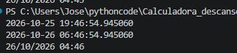

# Gestor de descansos

Programa en Python para calcular a qué hora puedo volver a conducir después de realizar un descanso diario.

La idea es ir añadiendo funciones poco a poco, mientras aprendo Python, hasta poder comprobar también los descansos semanales y bisemanales.

El objetivo final es **poder utilizarlo desde mi móvil Android**, de forma sencilla. Pulsar un botón al terminar la jornada y que el programa calcule automáticamente los descansos, sin tener que introducir fechas ni horas manualmente.

## Primera versión

De momento el programa:

- Obtiene la fecha y hora actuales.
- Calcula cuándo terminan las 11 horas de descanso normal.
- Calcula cuándo terminan las 9 horas de descanso reducido.
- Muestra los resultados por pantalla.

## Prueba de funcionamiento

## Próximos pasos

- Comprobar cuándo se puede utilizar un descanso reducido.
- Calcular los descansos semanales normales y reducidos.
- Controlar las compensaciones y los descansos entre semanas.
- Comprobar los cálculos según la normativa vigente.
- Crear una interfaz sencilla para utilizarlo en Android.

Por ahora solo calcula las horas. Todavía no comprueba si se cumplen todos los requisitos legales.